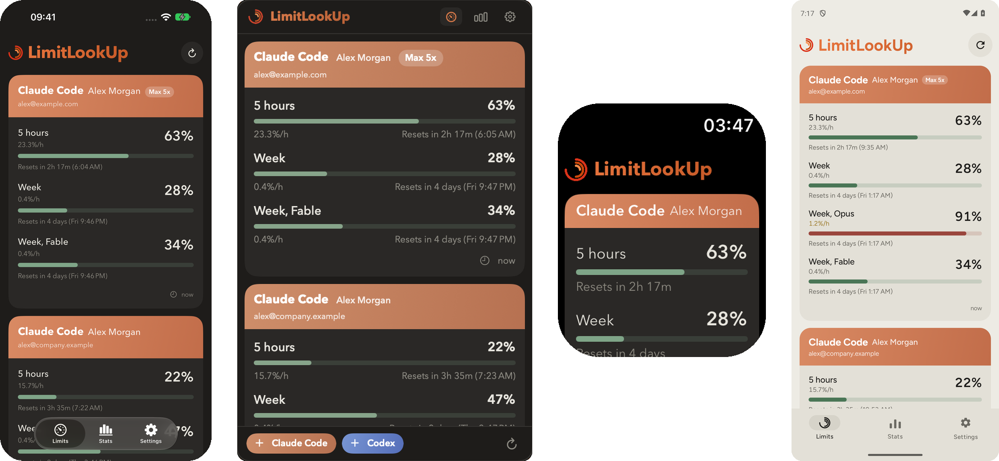
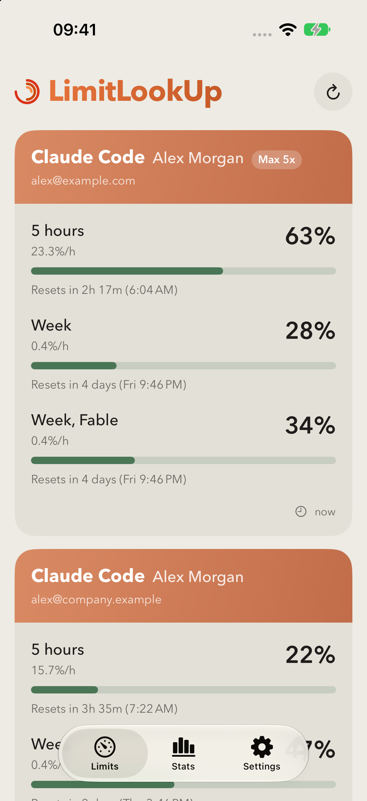
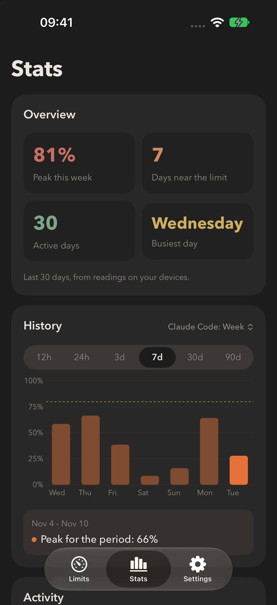
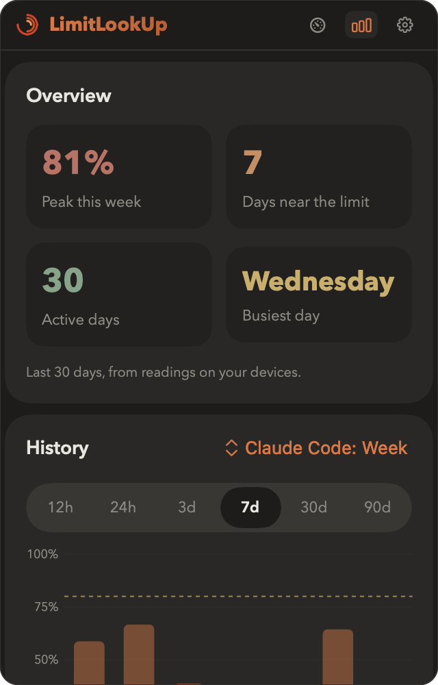
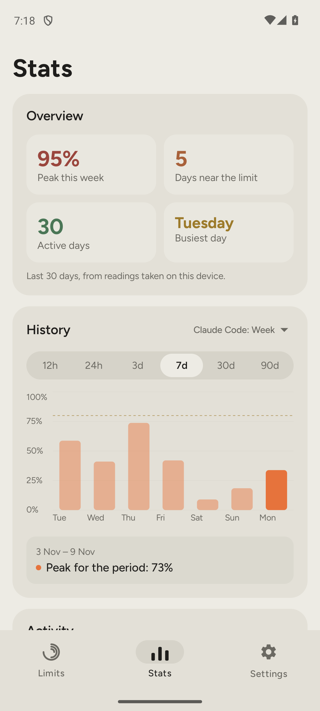

<div align="center">


# LimitLookUp

**Know exactly when your Claude Code and Codex limits reset.**

Usage limits for several accounts at once, on iPhone, Apple Watch, Mac and Android.<br>
Open source. No server, no analytics, no account of ours. You build it, you own it.

[](LICENSE)
[](https://github.com/idsaymichelle/LimitLookUp/releases/latest)


[](https://github.com/idsaymichelle/LimitLookUp/stargazers)

[Install](#install) · [Features](#features) · [Privacy](#privacy) · [FAQ](#faq) · [Build from source](#build-from-source)

<br>



</div>

## Why another limits app

Apps like this already exist in the App Store and Google Play. They all ask for the same thing: your sign-in to Claude or ChatGPT, handed to someone else's code that you can't read.

LimitLookUp is the opposite:

- **You can read every line.** The whole app is in this repository.
- **You build and install it yourself.** Nobody can push an update that changes what it does with your session.
- **Nothing to lose.** There is no LimitLookUp server or account. If this repository disappears tomorrow, the copy on your devices keeps working.
- **Fork it.** Change it, add a service, ship your own version. It's MIT.

## Features

|  | iPhone | Apple Watch | Mac | Android |
|---|:---:|:---:|:---:|:---:|
| Several accounts per service | ✓ | ✓ | ✓ | ✓ |
| 5-hour, weekly and per-model limits | ✓ | ✓ | ✓ | ✓ |
| Time until reset and burn rate (%/h) | ✓ | ✓ | ✓ | ✓ |
| Alerts: almost used up, reset, early reset | ✓ |  | ✓ | ✓ |
| Stats: peaks, history, busiest days | ✓ |  | ✓ | ✓ |
| Widgets | Home & Lock Screen |  | Menu bar | Home screen |
| Light and dark theme, 11 languages | ✓ | ✓ | ✓ | ✓ |

New limits that Anthropic adds (like *Week, Fable*) show up as their own row automatically.

<details>
<summary><b>More screenshots</b></summary>
<br>

| iPhone | | Mac | Android |
|:---:|:---:|:---:|:---:|
|  |  |  |  |

</details>

## Install

<details open>
<summary><b>Android</b>: download the APK</summary>
<br>

1. Open [Releases](https://github.com/idsaymichelle/LimitLookUp/releases/latest) on the phone and download `LimitLookUp.apk`.
2. Open the file. Android asks to allow installs from your browser: allow it, go back, tap **Install**.
3. Open LimitLookUp, tap **Add account** and sign in on claude.ai or chatgpt.com.

Android 8 or newer. For separate cookies per account the system WebView should be 121 or newer (it updates through Google Play).

</details>

<details>
<summary><b>Mac</b>: download the app</summary>
<br>

1. Download `LimitLookUp-Mac.zip` from [Releases](https://github.com/idsaymichelle/LimitLookUp/releases/latest), unzip it and move **LimitLookUp** to **Applications**.
2. Open it. macOS says it can't check the developer, because the app isn't notarized by Apple.
3. Open **System Settings → Privacy & Security**, scroll down and click **Open Anyway**.
4. The gauge icon appears in the menu bar. Click it, then add an account.

macOS 14 or newer. Right-click the icon to quit.

</details>

<details>
<summary><b>iPhone and Apple Watch</b>: build with Xcode (free Apple Account)</summary>
<br>

Apple doesn't allow installing iPhone apps from a file, so you build it once on a Mac. No paid account needed.

1. Install [Xcode](https://apps.apple.com/app/xcode/id497799835) and [XcodeGen](https://github.com/yonaskolb/XcodeGen):
   ```bash
   brew install xcodegen
   ```
2. Get the code:
   ```bash
   git clone https://github.com/idsaymichelle/LimitLookUp.git
   cd LimitLookUp
   ```
3. Bundle IDs must be unique to your Apple Account. Replace `com.limitlookup` with your own (for example `io.github.yourname`) in these files:
   ```bash
   sed -i '' 's/com\.limitlookup/io.github.yourname/g' project.yml App/App.entitlements Widget/Widget.entitlements Shared/Models.swift
   ```
4. Generate and open the project:
   ```bash
   xcodegen generate
   open LimitLookUp.xcodeproj
   ```
5. In Xcode, sign in under **Settings → Accounts**. Then for each target (**LimitLookUp**, **UsageWidget**, **LimitLookUpWatch**) open **Signing & Capabilities** and choose your **Personal Team**.
6. Connect the iPhone with a cable, select it at the top of Xcode and press **Run** (⌘R). The first run installs the app, but iOS won't open it yet.
7. On the iPhone, turn on **Settings → Privacy & Security → Developer Mode** and let the iPhone restart. The switch appears only after the iPhone has been connected to Xcode once.
8. Open **Settings → General → VPN & Device Management**, tap the **Apple Development: …** entry under **Developer App**, tap **Trust** and confirm.
9. Press **Run** in Xcode again. LimitLookUp opens on the iPhone.
10. **Apple Watch** (optional): the watch app is built into the iPhone app.
    - Keep the watch unlocked and near the iPhone, with the iPhone and the Mac on the same Wi-Fi.
    - In Xcode, click the device name at the top and choose **Manage Run Destinations…** (or press ⇧⌘2). Wait until the watch appears under the iPhone; the first time it can take a few minutes. Or choose the **LimitLookUpWatch** scheme, select your watch and press **Run**.
    - Only then does **Settings → Privacy & Security → Developer Mode** appear on the watch. Turn it on and let the watch restart.
    - Press **Run** again. If the app doesn't show up on the watch, open the **Watch** app on the iPhone → **My Watch** → **Available Apps** → **LimitLookUp** → **Install**.
    - Add accounts on the iPhone: the watch shows what the iPhone sends.

> [!NOTE]
> With a free Apple Account the app stops opening after **7 days**. Connect the iPhone and press Run again to renew it; your accounts and history stay. A free account also allows up to 3 of your own apps per device. A paid Apple Developer membership removes both limits.

</details>

## Privacy

- **No server.** The apps talk only to claude.ai and chatgpt.com, the same way their own pages do.
- **Your session stays on the device.** You sign in on the service's own page inside the app. Each account gets its own isolated web storage, so cookies are never shared between accounts and are never copied anywhere.
- **No analytics, no tracking, no ads.** No third-party code on Apple platforms; on Android only Google's AndroidX libraries.
- **What is stored:** percentages, reset times, account names you see in the app and the readings for stats. All of it on your device. Removing an account deletes its sign-in and history.

Found a security problem? See [SECURITY.md](SECURITY.md).

## FAQ

<details>
<summary><b>Is it safe to sign in through this app?</b></summary>
<br>
You sign in on the real claude.ai or chatgpt.com page, shown inside the app. The app never sees your password. It only uses the resulting session to ask the site for your usage, and it runs that request only when the page really is claude.ai or chatgpt.com. Since you build or download it from this repository, you can check all of this in the code: <code>App/Fetcher.swift</code> and <code>Android/.../Fetcher.kt</code>.
</details>

<details>
<summary><b>Why isn't it in the App Store or Google Play?</b></summary>
<br>
On purpose. The point is that you don't have to trust a store build you can't inspect.
</details>

<details>
<summary><b>Do alerts work when the app is closed?</b></summary>
<br>
Reset alerts are scheduled ahead of time and arrive even if the app is closed. "Almost used up" alerts need a fresh reading: iPhone and Android refresh in the background every 30 minutes or so (the system decides the exact time), the Mac app needs to be running.
</details>

<details>
<summary><b>The numbers stopped updating</b></summary>
<br>
Open the app and pull to refresh. If it says to sign in again, the site ended your session: tap <b>Sign in again</b>. If the site changed how it reports usage, the app can't read it until the code is updated; please open an <a href="https://github.com/idsaymichelle/LimitLookUp/issues">issue</a>.
</details>

<details>
<summary><b>The iPhone app stopped opening after a week</b></summary>
<br>
That's the 7-day limit of a free Apple Account. Connect the iPhone, open the project in Xcode and press Run.
</details>

<details>
<summary><b>Do my iPhone and Mac share accounts?</b></summary>
<br>
Each device signs in on its own. Sharing readings between devices goes through iCloud, which needs a paid Apple Developer membership when you build the app yourself.
</details>

<details>
<summary><b>Can I add another service?</b></summary>
<br>
Yes. A service is a case in <code>Service</code>, a short JavaScript request and a parser in <code>App/Fetcher.swift</code> (and the same in <code>Android/.../Model.kt</code>). Kimi and Qwen are already in the code, hidden from the list.
</details>

## Build from source

```
App/        iPhone app: screens, data loading, notifications (shared with Mac)
Widget/     Home Screen and Lock Screen widgets
Watch/      Apple Watch app (shows what the iPhone sends)
Mac/        Mac menu bar app
Shared/     models, theme, history, languages, iCloud sync
Tests/      response parsing checks
Android/    Android app (Kotlin, Jetpack Compose)
scripts/    translations and icon generators
```

**Apple:** `xcodegen generate`, then the `LimitLookUp` scheme (iPhone, watch, widgets) or `LimitLookUpMac`. Parsing checks without a simulator:

```bash
swiftc -parse-as-library Shared/Models.swift Shared/Theme.swift Shared/History.swift Shared/Lang.swift Shared/CloudSync.swift App/Fetcher.swift Tests/ParseCheck.swift -o /tmp/pc && /tmp/pc
```

**Android:** needs JDK 17 and the Android SDK.

```bash
cd Android && ./gradlew testDebugUnitTest assembleDebug
```

**Translations:** strings live in `Shared/Localizable.xcstrings`; `python3 scripts/translations.py` updates them, `python3 scripts/android_strings.py` copies them to Android.

**Sample data for screenshots** (debug builds only): run with `-demo` on Apple platforms, or `adb shell am start -n app.limitlookup/.MainActivity --ez demo true` on Android.

<details>
<summary><b>Publishing a release</b></summary>
<br>

- **Android:** `./gradlew assembleRelease`, sign the APK with your own key (never commit it), rename to `LimitLookUp.apk`.
- **Mac:** Xcode → Product → Archive for `LimitLookUpMac` → Distribute App → Copy App, zip it as `LimitLookUp-Mac.zip`.
- Attach both to a new release on GitHub.

</details>

## Contributing

Issues and pull requests are welcome. Please run the parsing checks for both platforms before sending a change, and never include real account data, cookies or screenshots with personal information.

## Disclaimer

LimitLookUp is an independent project. It is not affiliated with, endorsed or sponsored by Anthropic or OpenAI. Claude, Claude Code, ChatGPT and Codex are trademarks of their owners. The app reads the usage pages you see when signed in; they are not a public API and can change at any time.

**Use at your own risk.** Reading your usage this way may not be permitted by the terms of service of Anthropic or OpenAI. The authors are not responsible for any consequences of using the app, including rate limiting, suspension or loss of your accounts, lost data, or any other damage. The software is provided "as is", without warranty of any kind (see [LICENSE](LICENSE)). If you are not comfortable with this risk, don't use it.

## License

[MIT](LICENSE)
